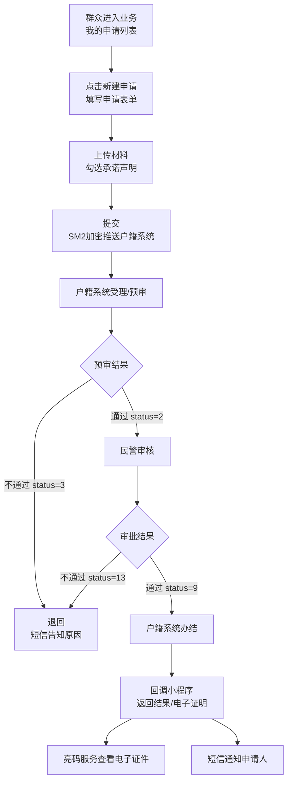
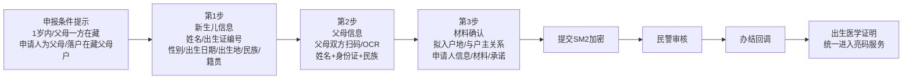
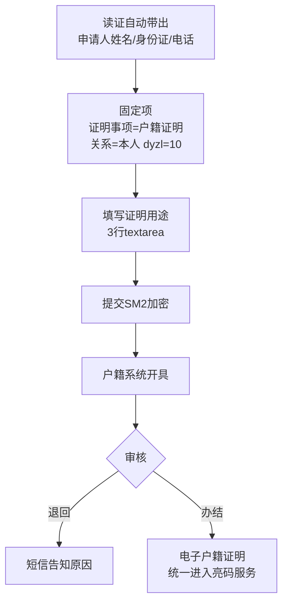
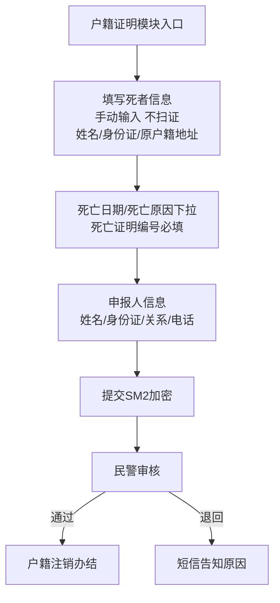
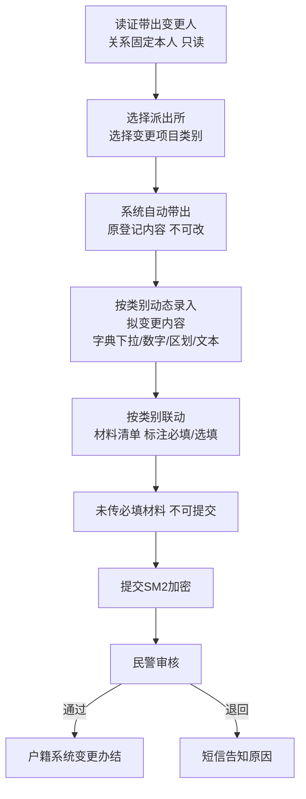
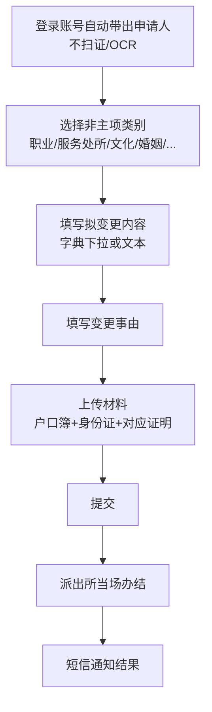
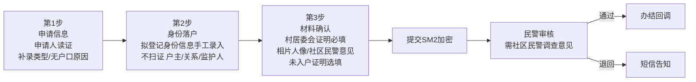
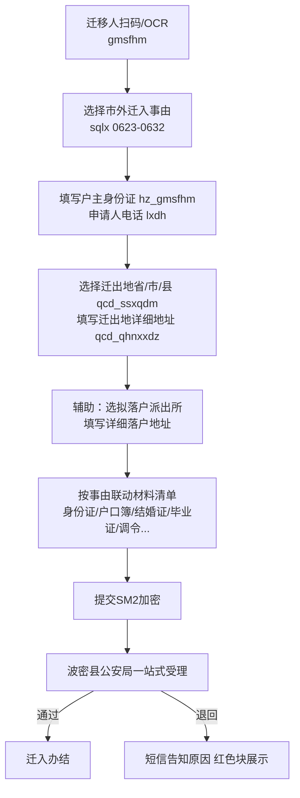

# 林芝公安户政业务 · 功能说明

> 版本：v1.1（基于《互联网+人口业务接口文档（新）0731》）
> 适用：波密县公安局户政业务线上申办原型
> 对接户籍系统统一入口：`http://ip:port/rkxt`，SM2 加密推送，业务回传地址 `/rkxt`
> 数据流：小程序表单 → SM2 加密推送户籍系统对应接口 → 公安/派出所审批 → 结果回调 → 电子证明回传 / 短信通知申请人。

---

## 一、总体业务流

```
小程序填表 → SM2 加密 POST 推送户籍系统对应接口
        ↓
户籍系统受理/派出所审批（人工）
        ↓
审批结果回调 /rkxt
  status: 9 办结 / 13 不通过 / 2 预审通过 / 3 预审未通过
        ↓
小程序回写状态 + 短信通知申请人
        ↓
办结业务：电子证明回传 fileList（base64 PDF），进入"亮码服务"
```

**统一规则**：
- 所有接口 `ywly` 林芝固定传 `9`
- 申请人姓名/身份证/联系电话由登录账号自动带出，不可修改
- 行政区划统一使用三级抽屉下拉（西藏全区字典），禁止手输
- 申请人身份信息录入处提供"扫林安码个人码"与"OCR 识别身份证"两种回填方式（按业务需要开关）
- 审批不通过的申请，列表与详情页以红色醒目块展示"退回原因"
- 民警审核端在本原型中隐藏（仅内部使用，不在申请人侧展示）

---

## 二、业务清单与对应接口

| 业务 | 入口位置 | 接口 URL | sqlx 业务类型 | 审批层级 |
|---|---|---|---|---|
| 出生登记（婚生） | 其他户政服务 | `/csdj` | 0101 | 派出所受理→县局审批 |
| 户籍证明开具 | 其他户政服务 | `/dysq` | dyzl=10 | 派出所当场办结 |
| 死亡注销申报 | 户籍证明模块内 | `/swzx` | 0401 | 派出所受理→县局审批 |
| 主项变更更正 | 其他户政服务 | `/bggzsq` | 1201（按变更项细分） | 派出所受理→县局审批 |
| 非主项变更 | 其他户政服务 | `/bggzsq` | 1210 | 派出所当场办结 |
| 户籍补录 | 其他户政服务 | 补录业务接口 | - | 派出所受理→县局审批 |
| 市外迁入 | 其他户政服务 | `/swqr` | 0623-0632 | 波密县公安局一站式受理 |
| 户籍迁移（市内移居） | 其他户政服务（占位） | `/swqr` | 0601-0622 | 后续启用 |

---

## 三、各业务功能说明

### 1. 出生登记（婚生） `/csdj`

**申报条件（第 1 步顶部醒目标注）**：
- 新生儿 1 周岁以内
- 婚生父母至少一方户口在西藏自治区内
- 申请人必须为父亲或母亲
- 新生儿必须落户到西藏有户口的父亲或母亲户内

**表单分 3 步**：

| 步骤 | 内容 | 关键字段（接口对应） |
|---|---|---|
| 第 1 步 新生儿信息 | 新生儿姓名、**出生医学证明编号**（cszmbh）、性别、出生日期、出生地、民族（在父母民族中选）、籍贯 | xm / cszmbh / xbdm / csrq / mzdm / csd_ssxqdm / jg_ssxqdm |
| 第 2 步 父母信息 | 父亲姓名+身份证+民族（fqGmsfhm/fqXm/fqMzdm）、母亲姓名+身份证+民族（mqGmsfhm/mqXm/mqMzdm），均支持扫林安码/OCR 自动回填 | fq_* / mq_* |
| 第 3 步 材料确认 | 拟入户地（父户/母户）、与户主关系（yhzgxdm）、申请人信息（自动带出）、材料清单、承诺签署 | hz_gmsfhm / yhzgxdm / sbr_gmsfhm / sbr_xm / lxdh |

**办结产物**：回传电子出生医学证明，进入"亮码服务"。

---

### 2. 户籍证明开具 `/dysq`

**规则**：
- 每次提交前必须人证核验一致
- 仅能开具申请人**本人**的户籍证明（ysqrgx_jtgxdm 固定 01）
- dyzl 固定 10

**表单字段**：
- 申请人姓名/身份证/联系电话（自动带出不可改）
- 证明用途（3 行 textarea，必填）
- 联系电话（11 位，接收短信）
- 隐藏字段：领取方式、出具方式、现居住地址（不展示给用户）

**办结产物**：回传电子户籍证明 PDF，进入"亮码服务"亮码展示。

---

### 3. 死亡注销申报 `/swzx`

**入口**：放在"户籍证明"模块内的醒目深色渐变入口条（业务上与户籍证明同模块办理）。

**表单字段**：
- 死者姓名、公民身份号码、原户籍地址（**手动输入，不启用扫证回填**）
- 死亡日期
- 死亡原因（rkglswyydm，下拉）
- **死亡证明编号（swzmbh，必填）**
- 申报人姓名/身份证/与死者关系/联系电话
- 已去除字段：死亡地点

**推送字段**：gmsfhm（死者）/ swrq / rkglswyydm / swzmbh / sqr_gmsfhm / sqr_xm / lxdh / sqlx=0401。

---

### 4. 主项变更更正 `/bggzsq`

**规则**：
- 申请人与变更人关系固定"本人"，只读不可修改
- 先选派出所，再选变更项目类别
- 变更项目与变更内容联动：选定类别后，对应字典字段给出下拉/输入
- 上传材料随变更内容自动标注"必填/选填"

**字段（接口对应）**：
- 申请人姓名/身份证/联系电话（自动带出）
- 变更数据项标识 bggzsjxbsf + 名称 bggzsjxmc
- 变更后内容 bggzhnr
- 联系电话 lxdh
- 材料清单 clxx[]（clmc/cyzjdm/dzwjnr base64）

---

### 5. 非主项变更 `/bggzsq`

**规则**：
- 派出所**当场办结**，免费，无需上报县局
- 申请人信息由登录账号自动带出，**不启用扫证/OCR 回填**
- 申请人与变更人关系固定本人

**可变更项目（字典 1201-1209）**：职业、服务处所、文化程度、婚姻状况、身高、血型、兵役状况、宗教信仰、联系电话、常住户口所在地住址。

---

### 6. 户籍补录

**场景**：历史户籍漏登/无户籍人员补登户口。

**表单分 3 步**：
- 第 1 步：补录原因、拟落户地派出所下拉
- 第 2 步：补录人身份信息（**手动输入，不启用扫证/OCR**，因补录人员本身无身份证）、父母/亲属信息
- 第 3 步：历史调查材料、村组证明、承诺

**说明**：户籍补录身份落户不支持扫林安码/OCR 识别。

---

### 7. 市外迁入 `/swqr`（独立业务）

**规则**：
- 由波密县公安局**一站式受理**，申请人无需返回原户籍地
- 与原"户籍迁移（市内移居）"完全分开，独立表单、独立历史列表

**推送字段（接口实际接收）**：

| 表单字段 | 接口字段 |
|---|---|
| 迁移人公民身份号码（扫林安码/OCR） | `gmsfhm` |
| 拟迁入户主公民身份号码 | `hz_gmsfhm` |
| 申请人联系电话（11 位） | `lxdh` |
| 市外迁入事由下拉（10 项） | `qyldyydm` / `sqlx` |
| 迁出地省/市/县（区划下拉） | `qcd_ssxqdm` |
| 迁出地区划内详细地址 | `qcd_qhnxxdz` |
| 申请人姓名/身份证（自动带出） | `sqr_xm` / `sqr_gmsfhm` |

**迁入事由字典 sqlx 0623-0632**：

| 编码 | 事由 |
|---|---|
| 0623 | 夫妻户口不在同一市，一方迁入对方户中 |
| 0624 | 父母与子女不在同一市，父母迁入子女户中 |
| 0625 | 父母与子女不在同一市，子女迁入父母户中 |
| 0626 | 其他非夫妻/父母/子女亲属投靠 |
| 0627 | 已就业大中专毕业生落单位集体户 |
| 0628 | 未就业大中专毕业生回市 |
| 0629 | 往届大中专毕业生回市 |
| 0630 | 干部职工调动落单位集体户 |
| 0631 | 录聘公务员落单位集体户 |
| 0632 | 随军家属迁入 |

**受理辅助采集（不推送接口）**：拟落户地派出所（波密 10 所下拉）、落户详细地址。

**材料联动**：选定事由后自动生成对应材料清单（如 0623 夫妻投靠 → 身份证+户口簿+结婚证；0627 毕业生 → 毕业证+劳动合同+单位集体户首页）。

---

### 8. 户籍迁移（市内移居，占位）

保留独立入口与表单，定位为**市内移居 0601-0622** 及其他后续迁移场景，本原型阶段暂不开放，待后续启用。

---

## 四、亮码服务

**统一入口**：小程序底部 Tab "亮码服务"，集中展示已办结并回传的电子证件。

| 证照 | 来源业务 | 展示内容 |
|---|---|---|
| 户籍证明 | 户籍证明开具（/dysq） | 姓名、身份证号、户口所在地、户别、事由、出具日期、有效期、电子签章 |
| 出生医学证明 | 出生登记（/csdj） | 新生儿姓名、性别、出生日期、父母信息、出生证编号、电子签章 |

**业务申请入口**仍保留在"其他户政服务"列表中，不在亮码页提供新建入口。

**按钮规则**：未走完审批流程的申请，"查看电子证件"按钮置灰不可用。

---

## 五、我的申请（历史列表）

- 不允许直接新增后跳过历史：所有业务均从"我的申请"进入，点"新建申请"才进入表单
- 列表以卡片式展示：业务名、申请编号、申请人、提交时间、摘要、状态
- 状态：待受理 / 审核中 / 已办结 / 已退回
- **已退回**：卡片与详情页以红色醒目块展示退回原因
- 详情页可查看：提交字段、上传材料、审批进度时间线、审批意见

---

## 六、统一组件与交互规范

| 组件 | 规则 |
|---|---|
| 扫证回填 | 扫林安码个人码 / OCR 识别身份证，按业务开关（出生登记父母信息、市外迁入迁移人等启用；死亡注销、户籍补录、非主项变更关闭） |
| 行政区划 | 三级抽屉下拉（省/市/县），西藏全区字典，禁止手输 |
| 派出所选择 | 波密县 10 个派出所下拉：扎木镇、倾多镇、松宗镇、古乡、玉普乡、易贡乡、多吉乡、康玉乡、玉许乡、八盖乡 |
| 材料上传 | 按业务类型与事由联动生成清单，必填/选填标签醒目 |
| 承诺签署 | 所有业务表单底部统一勾选承诺框 |
| 接口字段标注 | 原型中字段旁标注对应接口字段名（仅开发参考，正式版本隐藏） |

---

## 七、对接接口一览

| 接口 | 用途 | 关键字段 |
|---|---|---|
| POST `/rkxt` | 小程序→户籍系统（SM2 加密推送） | timeStamp / appId / parameter |
| POST `/rkxt`（接收） | 户籍系统→小程序 回调 | status(9/13/2/3) / result / opinion / checkTime / checkUserId / orgName / fileList[] |
| `/csdj` | 出生登记 | csrq / cszmbh / mq* / fq* / mzdm / xbdm / xm / hz_gmsfhm / yhzgxdm / csd_ssxqdm / jg_ssxqdm / clxx |
| `/dysq` | 户籍证明 | sqr_xm / sqr_gmsfhm / lxdh / dyzl=10 / gmsfhm / ysqrgx_jtgxdm=01 |
| `/bggzsq` | 变更更正（主项+非主项） | bggzhnr / bggzsjxbsf / bggzsjxmc / gmsfhm / lxdh / sqrGmsfhm / sqrXm / sqlx / clxx |
| `/swzx` | 死亡注销 | gmsfhm / swrq / rkglswyydm / swzmbh / sqr_gmsfhm / sqr_xm / lxdh / sqlx=0401 |
| `/swqr` | 市外迁入 / 市内移居 | gmsfhm / hz_gmsfhm / qyldyydm / qcd_ssxqdm / qcd_qhnxxdz / sqr_gmsfhm / sqr_xm / lxdh / sqlx |
| `/jbxx` | 基本信息查询 | gmsfhm（按身份证查户籍信息） |

---

## 八、业务流程图

### 1. 公共主线（所有业务通用）



### 2. 出生登记



### 3. 户籍证明



### 4. 死亡注销



### 5. 主项变更更正



### 6. 非主项变更



### 7. 户籍补录



### 8. 市外迁入



---

## 九、问题
 需要户籍系统技术员配合
 


