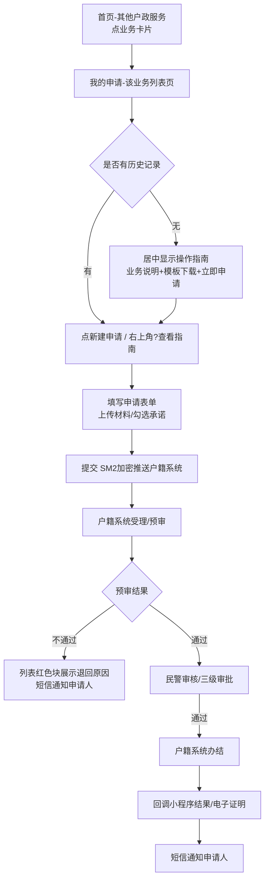
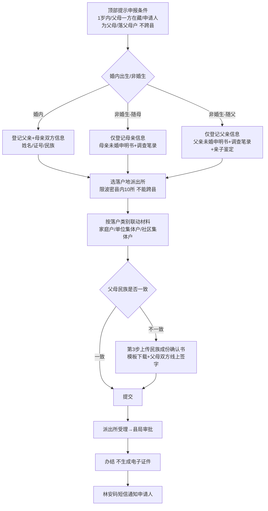
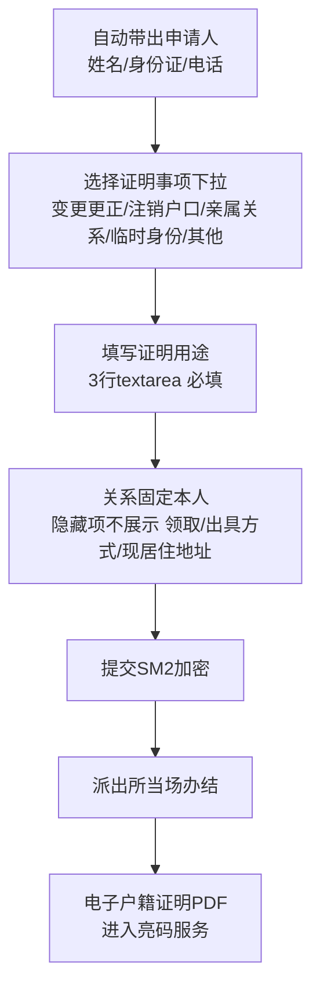
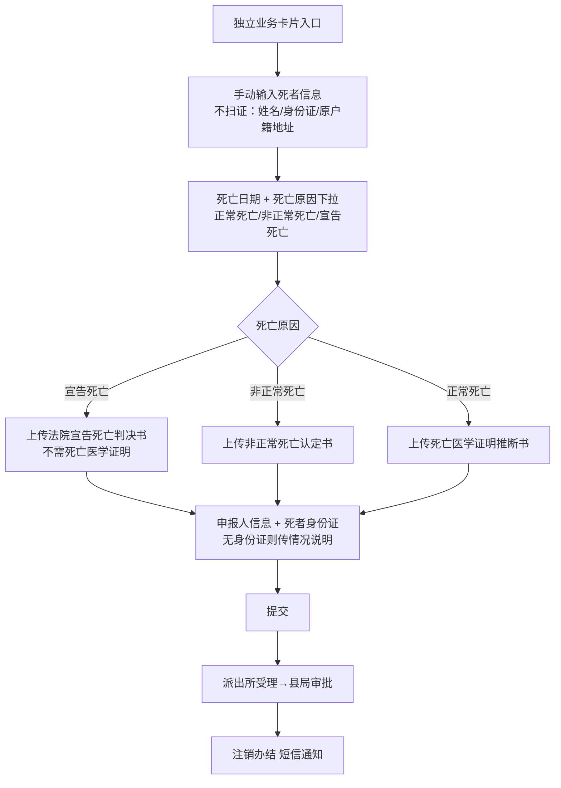
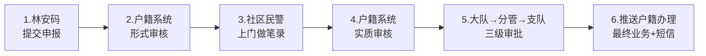
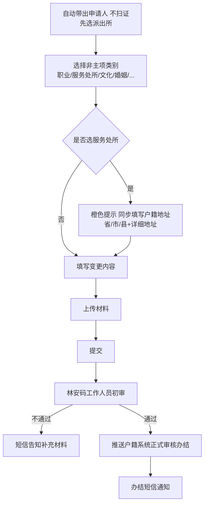
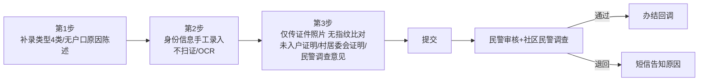
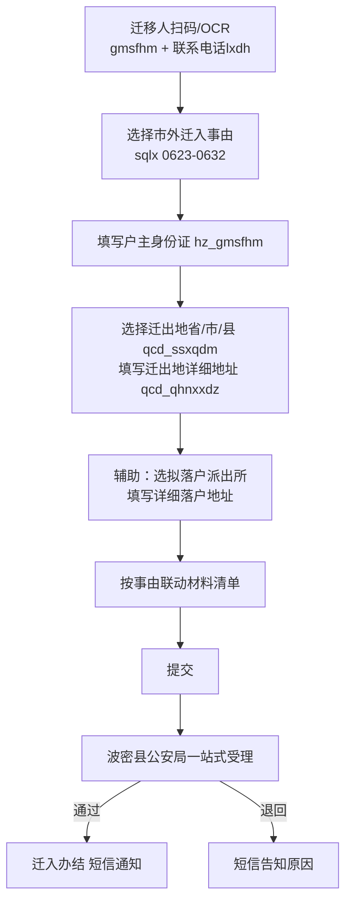
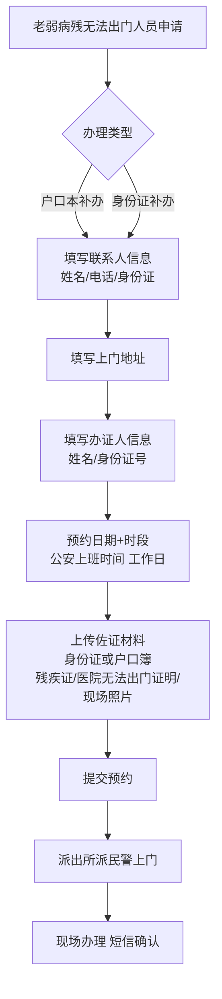

# 林芝公安户政业务 · 功能说明

> 版本：v1.2（基于《互联网+人口业务接口文档（新）0731》，已按当前原型实现对齐）
> 适用：公安局户政业务线上申办原型
> 对接户籍系统统一入口：`http://ip:port/rkxt`，SM2 加密推送，业务回传地址 `/rkxt`
> 数据流：小程序表单 → SM2 加密推送户籍系统对应接口 → 公安/派出所审批 → 结果回调 → 电子证明回传 / 短信通知申请人。

---

## 一、总体业务流

```
小程序填表 → SM2 加密 POST 推送户籍系统对应接口
        ↓
户籍系统受理/派出所审批（人工）
        ↓
审批结果回调 /rkxt
  status: 9 办结 / 13 不通过 / 2 预审通过 / 3 预审未通过
        ↓
小程序回写状态 + 短信通知申请人
        ↓
办结业务：电子证明回传 fileList（base64 PDF），进入"亮码服务"
```

**统一规则**：
- 所有接口 `ywly` 林芝固定传 `9`
- 申请人姓名/身份证/联系电话由登录账号自动带出，不可修改
- 行政区划统一使用三级抽屉下拉（西藏全区字典），禁止手输
- 申请人身份信息录入处提供"扫林安码个人码"与"OCR 识别身份证"两种回填方式（按业务需要开关）
- 审批不通过的申请，列表与详情页以红色醒目块展示"退回原因"
- 民警审核端在本原型中隐藏（仅内部使用，不在申请人侧展示）

---

## 二、业务清单与对应接口

| 业务 | 入口位置 | 接口 URL | sqlx 业务类型 | 审批层级 |
|---|---|---|---|---|
| 出生登记（婚内/非婚生） | 其他户政服务 | `/csdj` | 0101 | 派出所受理→县局审批 |
| 户籍证明开具 | 其他户政服务 | `/dysq` | dyzl=10 | 派出所当场办结 |
| 死亡注销申报 | 其他户政服务（独立卡片） | `/swzx` | 0401 | 派出所受理→县局审批 |
| 主项变更更正 | 其他户政服务 | `/bggzsq` | 1201（按变更项细分） | 派出所受理→社区民警上门→县局三级审批 |
| 非主项变更 | 其他户政服务 | `/bggzsq` | 1210 | 林安码初审→户籍系统办结 |
| 户籍补录 | 其他户政服务 | 补录业务接口 | - | 派出所受理→县局审批 |
| 市外迁入 | 其他户政服务（次要入口） | `/swqr` | 0623-0632 | 波密县公安局一站式受理 |
| 上门办证服务 | 其他户政服务 | 待户籍系统提供 | - | 派出所预约上门→现场办理 |
| 户籍迁移（市内移居） | 其他户政服务（次要入口/占位） | `/swqr` | 0601-0622 | 后续启用 |

---

## 三、各业务功能说明

### 0. 全局导航与操作指南

**导航层级**（所有业务统一）：
1. 首页 → 其他户政服务（业务卡片列表）
2. 点业务卡片 → 该业务"我的申请"列表页（历史记录）
3. 列表页点"新建申请" → 进入申报信息填写表单
4. 表单页左上角返回 → 回到该业务列表页
5. 列表页返回 → 回到其他户政服务首页

**操作指南机制**：
- 该业务**无历史记录**时，列表页居中展示操作指南卡片：业务图标、办理说明、所需表格模板下载列表、底部"立即申请"按钮
- 该业务**已有历史记录**时，操作指南入口收进表单页右上角圆形"?"按钮，点击从底部弹出抽屉展示办理说明和可下载模板

---

### 1. 出生登记 `/csdj`（sqlx=0101）

**申报条件（第 1 步顶部蓝色提示框醒目标注）**：
> 新生儿 1 岁以内；婚生父母至少一方户口在西藏自治区内；申请人必须为父亲或母亲；新生儿必须落户到西藏有户口的父亲或母亲户内（不能跨县落户）。

**表单分 3 步，第一步分「婚内出生 / 非婚生」两大类**：

| 步骤 | 内容 |
|---|---|
| 第 1 步 基本信息 | 顶部蓝色申报条件提示框；婚内出生 / 非婚生 两大卡片切换；新生儿姓名、出生医学证明编号、性别、出生日期、出生地（支持全国县级行政区划）、民族成份（在父母民族中选择）、籍贯 |
| 第 2 步 父母及落户 | 婚内：登记父亲+母亲双方姓名/证号/民族；**非婚生：按随父/随母只登记单方信息**（随母→母亲信息，随父→父亲信息）；拟落户方选择；**落户地派出所限波密县内 10 所**（扎木镇、倾多镇、松宗镇、古乡、玉普乡、易贡乡、多吉乡、康玉乡、玉许乡、八盖乡），不支持跨县落户；落户类别（家庭户/单位集体户/社区集体户）；拟落户户主姓名、与户主关系 |
| 第 3 步 材料确认 | 申领人身份、申请人信息自动带出；材料清单按申报类型与落户类别动态联动；**父母民族不一致时，在此步上传《民族成份确认书》并由父母双方线上签字** |

**特殊联动**：
- **父母民族不一致（婚内三种落户方式均适用）**：第 3 步弹出橙色提示，提供《民族成份确认书》模板下载，填写后上传，并须由父亲、母亲双方分别线上手写签字（必备）。
- **非婚生随父落户**：须额外上传亲子鉴定证明；**非婚生随母落户**：须提供母亲未婚申明书、派出所调查笔录。
- **落户类别联动材料**：
  - 落家庭户（落在房屋上）：上传「不动产权证书（房产证）或村、乡镇街道、派出所落户证明」；
  - 落单位集体户：上传单位出具的证明；
  - 落社区集体户：上传社区证明。
- **不生成电子证件**：审批通过后由户籍系统回调，林安码向申请人手机发送办理结果短信，不回传电子证照。

**接口字段**：xm / cszmbh / xbdm / csrq / mzdm / fq_* / mq_* / hz_gmsfhm / yhzgxdm / sbr_* / lxdh / csd_* / jg_* / clxx[]

---

### 2. 户籍证明开具 `/dysq`（dyzl=10）

**规则**：
- 每次提交前人证核验一致
- 仅能开具申请人**本人**的户籍证明（ysqrgx_jtgxdm 固定 01）
- dyzl 固定 10

**表单字段**：
- 申请人姓名/身份证/联系电话（自动带出不可改）
- **证明事项（下拉选择）**：户口登记项目内容变更更正证明 / 注销户口证明 / 亲属关系证明 / 临时身份证明 / 其他户籍证明
- 证明用途（**3 行高度 textarea**，必填，用于判断证明范围与是否属公安主管事项）
- 与被证明人关系（固定"本人"，只读）
- **隐藏字段**（按要求不展示）：领取方式、出具方式、现居住地址

**办结产物**：业务系统生成 PDF，回调 fileList 返回电子户籍证明，进入"亮码服务"展示。

---

### 3. 死亡注销申报 `/swzx`（sqlx=0401）

**入口**：作为独立业务卡片展示在"其他户政服务"列表，不再挂在户籍证明模块内。

**表单字段**：
- 死者姓名、公民身份号码、原户籍地址（**手动输入，不启用读证自动回填**）
- 死亡日期
- 死亡原因（下拉：正常死亡（病亡）/ 非正常死亡 / 宣告死亡；**已去掉"其他"选项**）
- 申报人姓名/身份证/与死者关系/联系电话
- 已去掉字段：死亡地点；**不采集任何死亡/认定/判决书编号字段**（死亡医学证明编号、非正常死亡认定书编号、法院宣告死亡判决书编号均不录入）

**材料联动**：
- 默认材料：死亡医学证明（推断）书、居民户口簿、申报人居民身份证、死者居民身份证（如无法提供须上传情况说明）。
- 死亡原因选**宣告死亡**：不要求上传死亡医学证明（推断）书，改传法院宣告死亡判决书。
- 死亡原因选**非正常死亡**：须上传非正常死亡认定书。
- 死亡原因选**正常死亡（病亡）**：按默认材料清单上传。

**接口字段**：gmsfhm / swrq / rkglswyydm / sqr_gmsfhm / sqr_xm / lxdh / clxx[]

---

### 4. 主项变更更正 `/bggzsq`

**页面双版本切换**（顶部胶囊切换，两版均保留）：
- **在线申报**：填写表单、上传材料并提交。
- **办理指引**：仅展示办理流程告知与所需材料、模板下载，无需在线填写与上传；准备齐全后可切回「在线申报」提交。

**顶部 6 步流程时间线**（深蓝渐变卡片可视化展示）：
1. 林安码提交申报
2. 户籍系统形式审核
3. 社区民警上门调查做笔录（有笔录表单）
4. 户籍系统实质审核
5. 大队 → 大队分管领导 → 支队审批
6. 审核完成推送户籍办理最终业务，同时短信通知群众

**变更项目（仅受理以下 6 类主项）**：姓名、性别、出生日期（年龄）、民族成份、籍贯、公民身份号码。

**二级变更原因（选定变更项目后联动出现）**：

| 变更项目 | 可选变更原因 |
|---|---|
| 姓名 | 自愿改名 / 重名 / 生僻字 / 离婚 / 收养 |
| 出生日期（年龄） | 一般变更 / 登记错误 |
| 民族成份 | 与实际不符 / 随父随母变更 |
| 籍贯 | 一般 / 登记错误 |
| 性别 | 医学性别变更 / 登记错误 |
| 公民身份号码 | 号码纠错 |

**材料配置（依据《主项变更需要提供的材料清单（附件一）》，基础材料 + 原因附加材料）**：
- **姓名（自愿改名基础）**：变更审批表（本人或监护人申请，可下载模板）、常住人口登记表复印件、户口本原件及复印件、本人身份证原件及复印件（未成年/无身份证提供监护人身份证）、无违法犯罪记录证明、2 份以上调查笔录；原因附加：重名→学校证明及花名册；生僻字→户籍地派出所证明；离婚→离婚判决书/协议书、双方申请及经司法机关公证的知情同意书；收养→收养登记证。
- **出生日期（年龄）基础**：变更审批表、常住人口登记表复印件、户口本、本人身份证、出生证明原件及复印件、其他能证明出生日期的证件材料、无违法犯罪记录证明、2 份以上调查笔录；登记错误附加：一代证或原始户口本、派出所登记错误民警情况说明。
- **民族成份基础**：变更审批表、常住人口登记表复印件、本人身份证、本人及父母三方户口本、父母或继父母婚姻关系证明、市一级民宗部门同意变更批复、2 份以上调查笔录；户口本无法体现父母子女关系的另需亲子鉴定。
- **籍贯基础**：变更审批表、常住人口登记表复印件、本人及父亲户口本、祖籍地公安机关证明、单位/组织/人事部门同意变更证明、2 份以上调查笔录；户口本无法体现父母子女关系的另需亲子鉴定；登记错误附加：民警录入错误情况说明。
- **性别（医学性别变更）基础**：变更审批表、常住人口登记表复印件、本人身份证、三甲医院性别鉴定、2 份以上调查笔录；登记错误附加：民警录入错误情况说明。
- **公民身份号码**：变更审批表、户口本、本人身份证、公民身份号码纠错证明材料。

**其他规则**：
- 申请人与变更人关系**固定"本人"，只读不可修改**。
- 监护人信息含监护人姓名、证号、**联系电话**（未满 18 周岁必填）。
- 「变更审批表」在材料清单中提供模板下载，填写后重新上传。
- 页面底部展示**不予受理情形**：刑罚未执行完毕或被采取刑事强制措施；民事案件未审结或未执行完毕；选取姓名违反公序良俗；已由本人/监护人申请并更正过出生日期；年满 18 周岁后两年内未提出民族成份变更申请。

**接口字段**：bggzhnr / bggzsjxbsf / bggzsjxmc / gmsfhm / lxdh / sqr_* / jhry_* / clxx[]

---

### 5. 非主项变更 `/bggzsq`

**顶部流程说明卡片**：
1. 群众在林安码提交申请并上传材料
2. 林安码工作人员初审，初审结果短信告知申请人
3. 初审通过的申请推送至户籍系统正式审核办结，办结后再次短信通知

**规则**：
- 仅可变更本人的非主项户口登记信息
- 先选派出所（接口要求）
- 申请人信息自动带出，不启用扫证/OCR

**可变更项目**：职业、服务处所、文化程度、婚姻状况、身高、血型、兵役状况、宗教信仰、联系电话、常住户口所在地住址。

**特殊联动**：
- 变更项目选"服务处所（从业单位）" → 自动弹出橙色提示框，要求**同步更新户籍地址**（省/市/县下拉 + 详细地址），切回其他类别自动隐藏

---

### 6. 户籍补录

**页首提示**：除以下可在线办理的补录情形外，其他户籍补录业务请携带相关材料到当地派出所咨询办理。

**可在线办理的补录类型（下拉 4 类）**：
1. 被宣告失踪或者宣告死亡后户口被注销人员
2. 农村地区因婚嫁被注销原籍户口的人员
3. 户口迁移证件遗失或者超过有效期限造成的无户口人员
4. 我国公民与外国人、无国籍人非婚生育的无户口人员

**表单分 3 步**：
- 第 1 步：申请人信息（读证回填）、补录类型下拉、无户口原因书面陈述。
- 第 2 步：拟登记身份信息（**手动输入，不启用扫林安码/OCR**）：姓名、性别、出生日期、民族、籍贯、出生地；拟落户户主姓名、与户主关系、监护人信息。
- 第 3 步：材料确认。
  - **相片上传**：仅上传近期标准证件照片（年满 16 周岁必填），**不做指纹比对**。
  - **社区民警调查**：民警上门后由系统出具，无需本人上传（两名以上民警询问申请人及两名以上知情人，制作询问笔录并出具综合调查报告）。
  - 必传材料：本人或监护人书面申请、出生证明材料（《出生医学证明》或亲子鉴定）、**原户籍地未入户证明**、**村（居）委会证明**、**社区民警调查意见**；选填：原始户籍档案、撤销失踪（死亡）文书、合法收养证明。

**说明**：身份落户不支持扫林安码和 OCR 识别。

---

### 7. 市外迁入 `/swqr`（sqlx=0623-0632）

**规则**：
- 由波密县公安局一站式受理，申请人无需返回原户籍地
- 与"户籍迁移（市内移居）"完全分开，独立表单、独立历史列表

**表单字段**：
- 迁移人信息（扫林安码/OCR 自动回填）：姓名、公民身份号码
- **联系电话**（必填，11 位）
- 拟迁入户主公民身份号码（hz_gmsfhm）
- 市外迁入事由下拉（10 项，见下表）
- 迁出地省/市/县（qcd_ssxqdm）+ 详细地址（qcd_qhnxxdz）
- 拟落户地派出所（波密 10 所下拉，辅助采集）
- 材料清单按事由联动

**迁入事由字典 sqlx 0623-0632**：

| 编码 | 事由 |
|---|---|
| 0623 | 夫妻户口不在同一市，一方迁入对方户中 |
| 0624 | 父母与子女不在同一市，父母迁入子女户中 |
| 0625 | 父母与子女不在同一市，子女迁入父母户中 |
| 0626 | 其他非夫妻/父母/子女亲属投靠 |
| 0627 | 已就业大中专毕业生落单位集体户 |
| 0628 | 未就业大中专毕业生回市 |
| 0629 | 往届大中专毕业生回市 |
| 0630 | 干部职工调动落单位集体户 |
| 0631 | 录聘公务员落单位集体户 |
| 0632 | 随军家属迁入 |

---

### 8. 上门办证服务（新增业务）

**适用对象**：仅限老弱病残等无法出门人员，民警预约上门办理。

**办理类型**：户口本补办 / 身份证补办（卡片切换）。

**表单字段**：
- 申请人信息（联系人）：姓名、联系电话、公民身份号码
- 上门地址（详细到门牌号）
- 办证人信息（实际需上门人员）：姓名、公民身份号码
- 预约上门日期（日历选择，限公安上班时间）
- 预约上门时段（上午 09:00-12:00 / 下午 15:00-18:00 共 6 个时段，仅工作日）
- 佐证材料（两项必填）：
  - 办证人居民身份证或户口簿照片
  - 残疾证或医院出具的无法出门证明或现场照片
- 承诺勾选

**说明**：该业务接口文档暂未提供，需户籍系统后续确认接口地址与字段。

---

### 9. 户籍迁移（市内移居，占位）

保留独立入口与表单，定位为市内移居 0601-0622 及其他后续迁移场景，本原型阶段暂不开放，待后续启用。

---

## 四、亮码服务

**统一入口**：小程序底部 Tab "亮码服务"，集中展示已办结并回传的电子证件。

| 证照 | 来源业务 | 展示内容 |
|---|---|---|
| 户籍证明 | 户籍证明开具（/dysq） | 姓名、身份证号、户口所在地、户别、事由、出具日期、有效期、电子签章 |
| 出生医学证明 | 出生登记（/csdj） | 新生儿姓名、性别、出生日期、父母信息、出生证编号、电子签章 |

**业务申请入口**仍保留在"其他户政服务"列表中，不在亮码页提供新建入口。

**按钮规则**：未走完审批流程的申请，"查看电子证件"按钮置灰不可用。

---

## 五、我的申请（历史列表）

- 进入路径：从"其他户政服务"点业务 → 先进入该业务的**列表页**，点"新建申请"才进入申报填写页；不能从服务列表直接跳到填报页。
- 返回层级：填报页左上角返回先回到该业务列表页，列表页再返回才回到首页，不直接回首页。
- 列表以卡片式展示：业务名、申请编号、申请人、提交时间、摘要、状态
- 状态：待受理 / 审核中 / 已办结 / 已退回
- **已退回**：卡片与详情页以红色醒目块展示退回原因
- 详情页可查看：提交字段、上传材料、审批进度时间线、审批意见
- **操作指南入口**：该业务无历史申请记录时，列表页中心位置展示操作指南（含所需表单模板下载）；已有历史申请后，操作指南入口收至新增填报页右上角。

---

## 六、统一组件与交互规范

| 组件 | 规则 |
|---|---|
| 扫证回填 | 扫林安码个人码 / OCR 识别身份证，按业务开关（出生登记父母信息、市外迁入迁移人等启用；死亡注销、户籍补录、非主项变更关闭） |
| 行政区划 | 三级抽屉下拉（省/市/县），西藏全区字典，禁止手输 |
| 派出所选择 | 波密县 10 个派出所下拉：扎木镇、倾多镇、松宗镇、古乡、玉普乡、易贡乡、多吉乡、康玉乡、玉许乡、八盖乡 |
| 材料上传 | 按业务类型与事由联动生成清单，必填/选填标签醒目 |
| 承诺签署 | 所有业务表单底部统一勾选承诺框 |
| 接口字段标注 | 原型中字段旁标注对应接口字段名（仅开发参考，正式版本隐藏） |

---

## 七、对接接口一览

| 接口 | 用途 | 关键字段 |
|---|---|---|
| POST `/rkxt` | 小程序→户籍系统（SM2 加密推送） | timeStamp / appId / parameter |
| POST `/rkxt`（接收） | 户籍系统→小程序 回调 | status(9/13/2/3) / result / opinion / checkTime / checkUserId / orgName / fileList[] |
| `/csdj` | 出生登记 | csrq / cszmbh / mq* / fq* / mzdm / xbdm / xm / hz_gmsfhm / yhzgxdm / csd_ssxqdm / jg_ssxqdm / clxx |
| `/dysq` | 户籍证明 | sqr_xm / sqr_gmsfhm / lxdh / dyzl=10 / gmsfhm / ysqrgx_jtgxdm=01 |
| `/bggzsq` | 变更更正（主项+非主项） | bggzhnr / bggzsjxbsf / bggzsjxmc / gmsfhm / lxdh / sqrGmsfhm / sqrXm / sqlx / clxx |
| `/swzx` | 死亡注销 | gmsfhm / swrq / rkglswyydm / swzmbh / sqr_gmsfhm / sqr_xm / lxdh / sqlx=0401 |
| `/swqr` | 市外迁入 / 市内移居 | gmsfhm / hz_gmsfhm / qyldyydm / qcd_ssxqdm / qcd_qhnxxdz / sqr_gmsfhm / sqr_xm / lxdh / sqlx |
| `/jbxx` | 基本信息查询 | gmsfhm（按身份证查户籍信息） |

---

## 八、业务流程图

### 1. 公共主线（所有业务通用）



### 2. 出生登记



### 3. 户籍证明



### 4. 死亡注销



### 5. 主项变更更正（6步流程）



**版本与材料：**
- 页面提供「在线申报 / 办理指引」双版本切换；指引版仅流程告知 + 材料/模板下载，不填报不上传。
- 变更项目仅 6 类：姓名、性别、出生日期（年龄）、民族成份、籍贯、公民身份号码；选定项目后联动二级「变更原因」字典。
- 材料按附件一清单生成（基础材料 + 原因附加材料），变更审批表提供模板下载。
- 申请人与变更人关系固定"本人"只读；监护人（未满 18 周岁）含联系电话。

### 6. 非主项变更



### 7. 户籍补录



### 8. 市外迁入



### 9. 上门办证服务（新增）



---

## 九、问题
 需要户籍系统技术员配合
 


---

## 十、接口字段差异分析（对照《互联网+接口文档(新)0731-林芝》）

> 本节列出当前原型表单字段与户籍系统接口文档的对应情况，**🔴 标记接口未提供、需户籍系统侧确认或扩展的差异点**。

### 10.1 出生登记 /csdj（sqlx=0101）

| 原型字段 | 接口字段 | 状态 |
|---|---|---|
| 新生儿姓名 xm | xm | ✅ |
| 出生医学证明编号 cszmbh | cszmbh | ✅ |
| 性别 xbdm | xbdm | ✅ |
| 出生日期 csrq | csrq | ✅ |
| 新生儿民族 mzdm | mzdm | ✅（限父母民族中选） |
| 父亲姓名/证号/民族 | fqXm / fqGmsfhm / fqMzdm | ✅ |
| 母亲姓名/证号/民族 | mqXm / mqGmsfhm / mqMzdm | ✅ |
| 申报人姓名/证号/电话 | sbr_xm / sbr_gmsfhm / lxdh | ✅（自动带出不可改） |
| 申报人与出生人关系 | sbr_ycsrgx_jtgxdm | ✅（接口限制只能父母，原型"其他监护人"选项需去掉） |
| 拟落户户主/与户主关系 | hz_gmsfhm / yhzgxdm | ✅ |
| 出生地省/市/县 | csd_ssxqdm | ✅ |
| 籍贯省/市/县 | jg_ssxqdm | ✅ |
| 申请日期 sqlx/hlwid/ywly=9 | sqrq / sqlx / hlwid / ywly | ✅（后端自动拼接） |

**🔴 差异点：**
1. **非婚生（随父/随母）登记接口未提供**：接口文档明确"互联网只申请婚生出生登记（sqlx 只展示国内婚生并置灰）"，原型新增的"非婚生（随父/随母）"流程**接口不支持**，需确认是否走线下/单独接口。
2. **出生地/籍贯缺"详细地址"字段**：接口要求 `csd_qhnxxdz`、`jg_qhnxxdz`（城市填至区或不涉区的市，农村填至乡镇），原型只有三级区划下拉，**需补详细地址输入框**。
3. **出生地/籍贯缺"国家地区"字段**：接口有 `csd_gjhdqdm`、`jg_gjhdqdm`，原型默认中国，需在字典里固化。
4. **拟落户地派出所（10所下拉）无对应接口字段**：接口未传派出所编码，推测根据 hz_gmsfhm 反查户内所在派出所，需后端确认。
5. **落户类别（家庭户/单位集体户/社区集体户）无对应接口字段**：接口未提供该字段，需确认是否需要上传或仅作内部参考。
6. **民族确认书**：接口无独立字段，作为 clxx[] 材料上传即可。
7. **不生成电子证件**：接口回调 fileList 对出生登记可不返回，由林安码发短信通知，与接口约定一致。

---

### 10.2 户籍证明 /dysq（dyzl=10）

| 原型字段 | 接口字段 | 状态 |
|---|---|---|
| 申请人姓名/证号/电话 | sqr_xm / sqr_gmsfhm / lxdh | ✅（自动带出不可改） |
| 证明种类（固定户籍证明） | dyzl=10 | ✅ |
| 与申请人关系（固定本人） | ysqrgx_jtgxdm=01 | ✅ |
| 打印人证号（=申请人） | gmsfhm | ✅ |
| 申请日期/hlwid/ywly=9 | sqrq / hlwid / ywly | ✅ |

**🔴 差异点：**
1. **"证明用途"输入框接口无对应字段**：接口文档未列证明用途，需确认是否需要传输或仅前端留痕。
2. **"现居住地址/领取方式/出具方式"已按要求隐藏**：接口本身也无这些字段，一致。
3. 电子证明由业务系统生成 PDF，回调 fileList 返回，与原型"亮码服务"展示一致。

---

### 10.3 主项变更更正 /bggzsq

| 原型字段 | 接口字段 | 状态 |
|---|---|---|
| 申请人姓名/证号/电话 | sqrXm / sqrGmsfhm / lxdh | ✅（自动带出） |
| 变更后内容 | bggzhnr | ✅ |
| 变更数据项标识符 | bggzsjxbsf | ✅ |
| 变更数据项名称 | bggzsjxmc | ✅ |
| 变更人证号 | gmsfhm | ✅ |
| 申请日期/hlwid/ywly | sqrq / hlwid / ywly=9 | ✅ |
| 监护人一姓名/证号/电话/关系 | jhry_xm / jhry_gmsfhm / jhry_lxdh / jhry_jhgxdm | ✅ |
| 监护人二姓名/证号/电话/关系 | jhre_xm / jhre_gmsfhm / jhre_lxdh / jhre_jhgxdm | ✅ |
| 父亲/母亲/配偶信息 | fq_* / mq_* / po_* | ✅ |
| 材料清单 | clxx[] | ✅ |

**🔴 重大差异点：**
1. **接口 sqlx 字典（1201-1209）全为非主项变更**：血型/文化程度/婚姻状况/宗教信仰/身高/兵役状况/服务处所/职业——**接口字典中没有"姓名、性别、出生日期、民族、籍贯"变更的 sqlx 编码**。原型把"主项变更"做成了这 5 类，但接口未提供对应审批流编码，需户籍系统补充 sqlx 字典。
2. **出生日期更正**：接口文档单独列了"更正出生日期（预约）"，要求选择"普通公民/组织人事部门管理干部"身份，且流程节点待确定——原型未做该身份选择，需补。
3. **社区民警上门笔录**：接口文档未提及该节点，原型按用户要求设计了 6 步流程（含社区民警上门笔录），**接口回调只有 status 9/13/2/3，没有中间"待笔录"状态**，需后端确认笔录节点如何对接。
4. **大队/分管领导/支队三级审批**：接口回调只有 checkUserId/deptId/orgName 单级，**未体现多级审批流程**，需后端确认。
5. **监护人联系电话**：接口字段 `jhry_lxdh` / `jhre_lxdh` 已有 ✅。
6. **各类原因附加材料**（重名学校证明/生僻字派出所证明/离婚公证同意书/民宗部门批复/三甲医院性别鉴定等）：接口无独立字段，统一走 clxx[] 材料上传。
7. **变更审批表模板**：前端提供模板下载、填写后重新上传，材料走 clxx[]。

---

### 10.4 非主项变更 /bggzsq

| 原型字段 | 接口字段 | 状态 |
|---|---|---|
| 申请人信息 | 自动带出 | ✅ |
| 变更项目类别下拉 | bggzsjxbsf | ✅ |
| 变更后内容 | bggzhnr | ✅ |
| 材料 | clxx[] | ✅ |

**🔴 差异点：**
1. **接口要求"先选派出所"**：原型非主项变更表单**未提供派出所选择入口**，需补。
2. **接口字典有 `cyzk_zagldwbm`（从业单位编码）**：原型只有单位名称，缺单位编码。
3. 非主项变更由派出所当场办结，与接口"全程网办"一致。

---

### 10.5 死亡注销 /swzx（sqlx=0401）

| 原型字段 | 接口字段 | 状态 |
|---|---|---|
| 死者证号 | gmsfhm | ✅ |
| 死亡日期 | swrq | ✅ |
| 死亡原因 | rkglswyydm | ✅（字典值待户籍系统提供） |
| 申报人证号/姓名 | sqr_gmsfhm / sqr_xm | ✅ |
| 联系电话 | lxdh | ✅ |
| sqlx/hlwid/ywly | sqlx=0401 / hlwid / ywly=9 | ✅ |

**🔴 差异点：**
1. **死者姓名/原户籍地址**：接口无这两个字段，由 gmsfhm 反查，原型手填的死者姓名/地址仅作前端展示，不传接口。
2. **判决书/认定书作为材料上传**：宣告死亡上传法院宣告死亡判决书、非正常死亡上传非正常死亡认定书，接口无独立编号字段，均走 clxx[] 材料上传。
3. **死亡原因字典**：接口 `rkglswyydm` 的具体字典值未在文档中列出，需户籍系统提供（原型暂用"正常死亡（病亡）/非正常死亡/宣告死亡"三项）。
4. **死者身份证（缺失传情况说明）**：走 clxx[] 材料上传。
5. **原型不采集任何编号字段**：死亡医学证明编号、非正常死亡认定书编号、法院宣告死亡判决书编号均不在表单录入，仅对应材料上传。

---

### 10.6 市外迁入 /swqr（sqlx=0623-0632）

| 原型字段 | 接口字段 | 状态 |
|---|---|---|
| 迁移人证号 | gmsfhm | ✅ |
| 户主证号 | hz_gmsfhm | ✅ |
| 迁移事由 | qyldyydm（sqlx 0623-0632） | ✅ |
| 迁出地省/市/县 | qcd_ssxqdm | ✅ |
| 迁出地详细地址 | qcd_qhnxxdz | ✅ |
| 申请人证号/姓名/电话 | sqr_gmsfhm / sqr_xm / lxdh | ✅ |
| sqlx/hlwid/ywly | sqlx / hlwid / ywly=9 | ✅ |

**🔴 差异点：**
1. **拟落户地派出所下拉**：接口无对应字段，推测根据 hz_gmsfhm 反查，需后端确认。
2. **落户详细地址**：接口只有迁出地详细地址（qcd_qhnxxdz），**迁入地详细地址无对应字段**，需确认是否需要传输。
3. **被投靠人信息（姓名/与迁移人关系）**：接口只有 hz_gmsfhm，姓名/关系由户主证号反查，原型手填的被投靠人信息仅作展示。
4. **单位信息（单位名称/单位集体户）**：接口无独立字段，走 clxx[] 材料上传（毕业证/调令/劳动合同等）。
5. **sqlx 字典 0623-0632 共 10 类事由**，与原型对齐 ✅。

---

### 10.7 户籍补录

**🔴 接口文档完全未提供户籍补录相关接口**，当前原型为前端占位，需户籍系统后续提供：
- 提交地址、字段定义、sqlx 编码
- 是否需要村居委会证明、社区民警调查笔录等节点

---

### 10.8 上门办证服务（新增）

**🔴 接口文档完全未提供该业务接口**，当前为业务侧新增需求（老弱病残上门补办户口本/身份证），需：
- 户籍系统提供提交接口地址、字段定义
- 明确是否复用现有 /swqr 或新建专用接口
- 预约上门时间、办证人信息、佐证材料等字段需后端确认
- 民警上门后现场办理的流程如何与户籍系统衔接

---

### 10.9 通用差异

| 项 | 说明 |
|---|---|
| hlwid（互联网事项 id） | 所有接口都要求，由后端按事项编码拼接，前端不传 |
| ywly=9 | 林芝统一固定值，后端拼接 |
| SM2 加密 | 所有提交 body 为 SM2 加密 JSON 串，前端只负责组包 |
| 回调 /rkxt | status 9 办结 / 13 不通过 / 2 预审通过 / 3 预审未通过；fileList 返回电子证明 PDF；opinion 退回原因 |
| 回调状态码不足 | 主项变更需要"待社区民警笔录""大队审批中""支队审批中"等中间状态，当前回调只有 4 个状态，需后端扩展 |
| 短信通知 | 办结后由林安码侧发送短信，原型已在各业务页注明 |

---

### 10.10 待户籍系统确认清单（汇总）

1. 🔴 **非婚生（随父/随母）出生登记是否走互联网接口**（当前文档仅支持婚生）
2. 🔴 **主项变更（姓名/性别/出生日期/民族/籍贯）的 sqlx 审批流编码**（文档字典 1201-1209 全为非主项）
3. 🔴 **主项变更多级审批节点回调状态**（社区民警笔录→大队→分管领导→支队，当前回调 status 不足）
4. 🔴 **出生日期更正的"普通公民/干部"身份选择**及流程节点
5. 🔴 **户籍补录接口地址与字段**（文档未提供）
6. 🔴 **上门办证服务接口地址与字段**（新增业务，文档未提供）
7. 🟡 出生地/籍贯"详细地址 csd_qhnxxdz/jg_qhnxxdz"前端是否补输入框
8. 🟡 市外迁入"迁入地详细地址"接口是否需要传
9. 🟡 户籍证明"证明用途"字段是否需要传后端
10. 🟡 死亡原因 `rkglswyydm` 字典值
11. 🟡 非主项变更"先选派出所"前端补派出所下拉
12. 🟡 从业单位编码 `cyzk_zagldwbm` 是否需要前端录入
